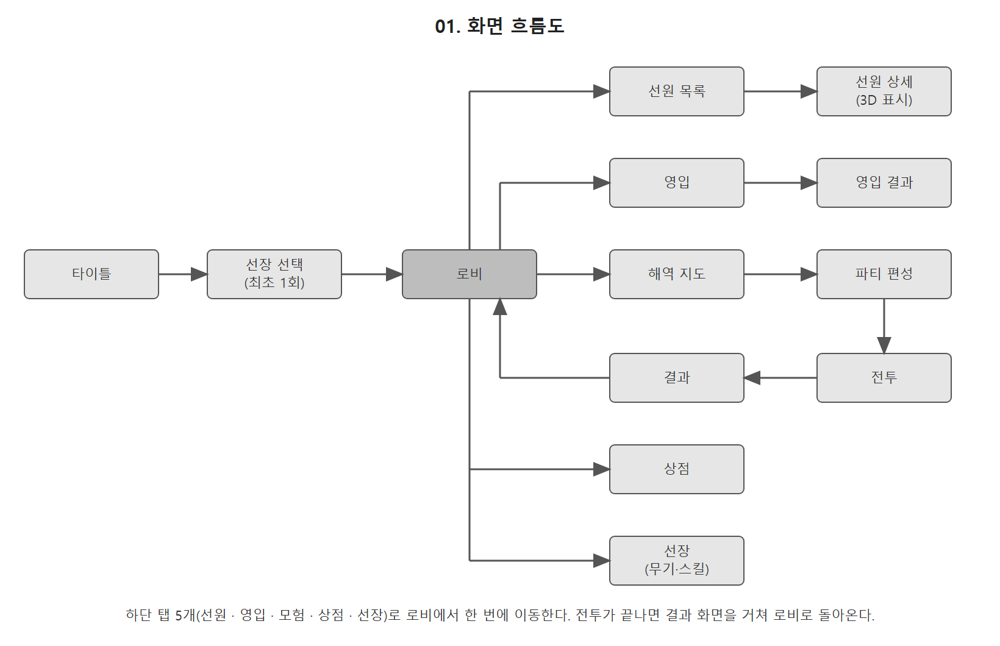
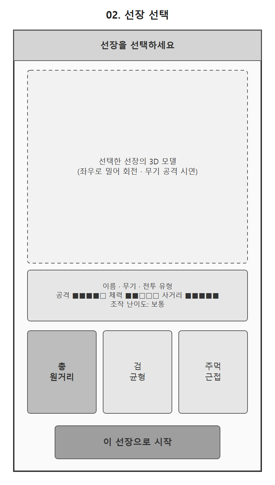
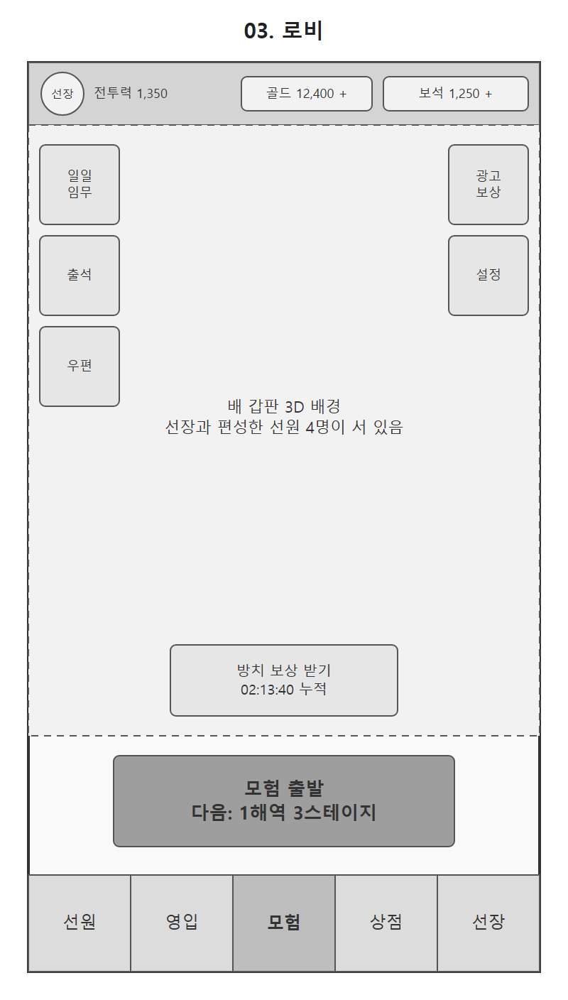
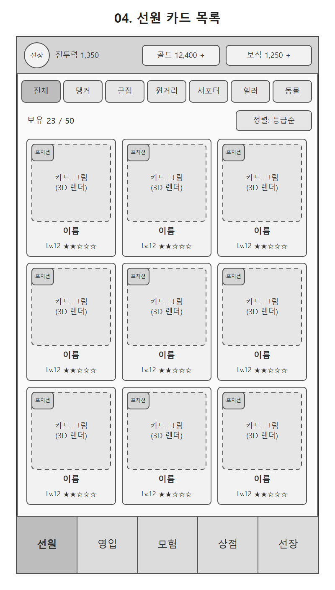
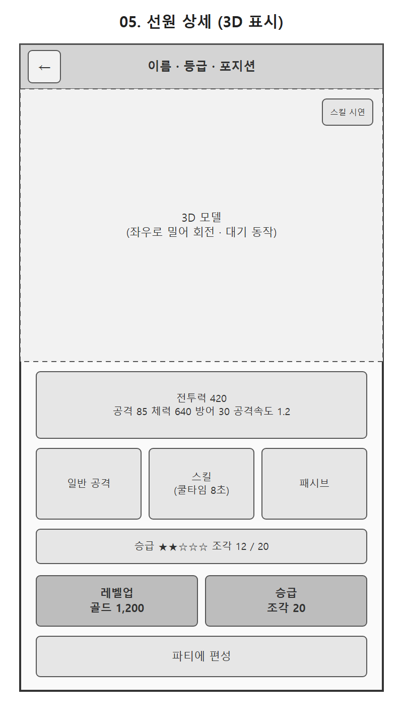
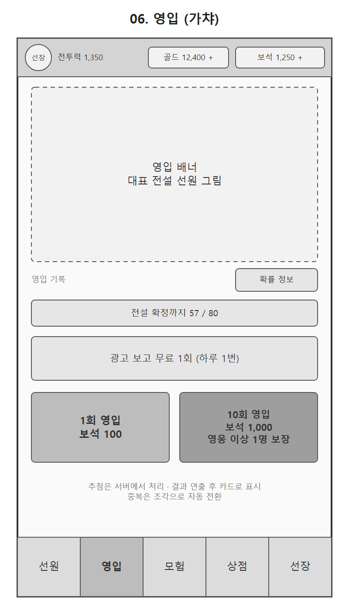
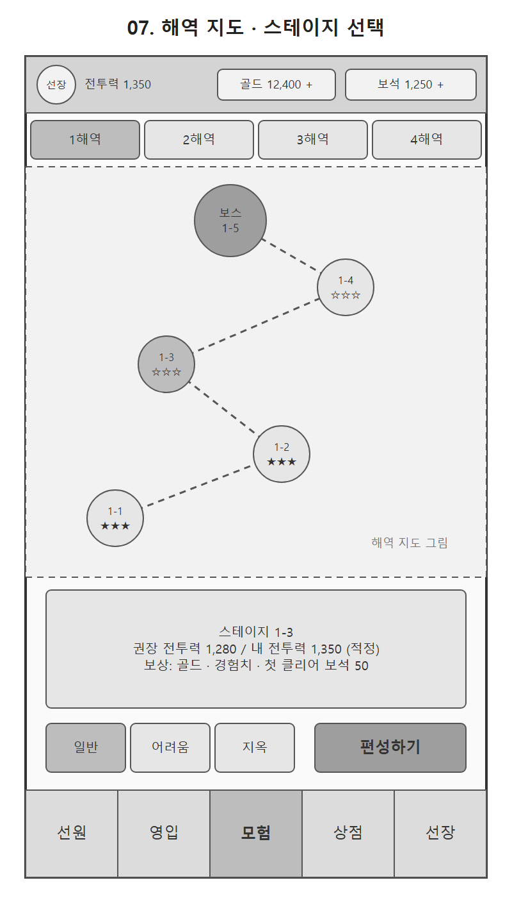
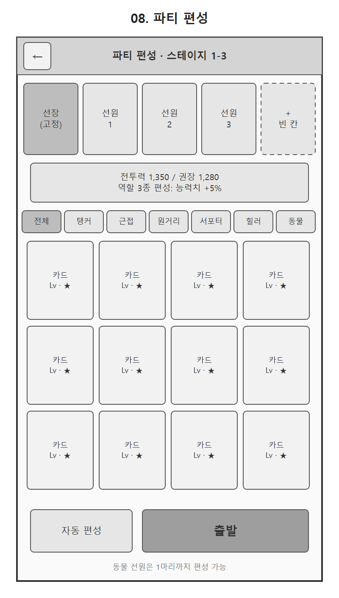
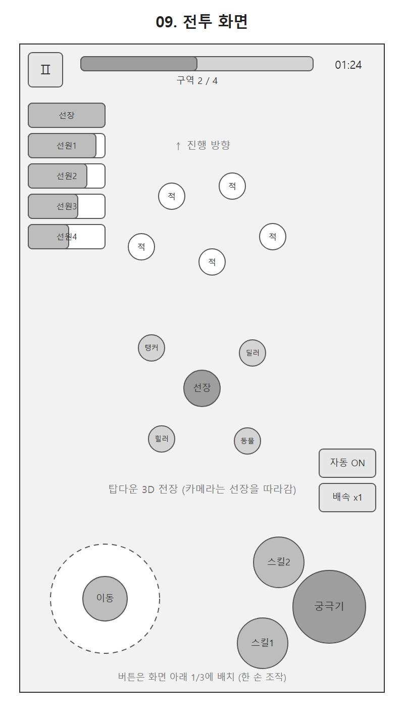

# 해적왕 키우기 (Pirate King) — 게임 기획서

- 문서 버전: 0.2 (2026-11-12)
- 표기: **[확정]** = 정해진 내용, **[제안]** = 추천안으로 아직 미확정. 결정 기록은 `DECISIONS.md`, 개발 환경은 `SETUP.md` 참고.
- 이 문서의 수치는 모두 초안이다. 실제 값의 원본은 Google Sheets이며 플레이테스트로 조정한다.

## 1. 개요

| 항목 | 내용 |
|---|---|
| 제목 | 해적왕 키우기 (Pirate King) [확정] |
| 장르 | 3D 탑다운 수집형 액션 RPG [제안] |
| 플랫폼 / 방향 | Android (Google Play) / 세로 [확정] |
| 엔진 | Unity 6 (URP), C# [확정] |
| 수익 모델 | 무료 + 가챠(인앱결제로 재화 구매) + 광고 [확정] |
| 서버 | Unity Gaming Services [확정] |
| 개발 인원 | 1인 |
| 1회 플레이 | 스테이지당 2~3분 [제안] |

**핵심 재미 [제안]:** "내가 고른 선장으로 직접 싸우고, 뽑은 선원으로 해적단을 완성해 간다."

1. 선장 조작의 손맛: 피하고, 스킬을 맞히는 짧은 전투
2. 선원 수집과 조합: 50종 중 4명을 골라 역할을 맞추는 재미
3. 성장 체감: 막혔던 보스를 성장 후 다시 도전해 넘는 순간

**세계관 [제안]:** 전설의 해적왕이 사라지며 남긴 "왕의 해도"가 네 조각으로 찢겨 네 바다에 흩어졌다. 조각을 모두 모은 자가 다음 해적왕이 된다. 플레이어는 작은 배 한 척과 선장 한 명으로 시작해 선원을 모으고 네 해역을 차례로 돌파한다. 이야기는 해역 시작과 보스 전후의 짧은 대사로만 전달한다(컷신 없음).

## 2. 게임 루프

```
모험(스테이지) → 골드·경험치·보석 획득 → 선원 영입 / 성장 → 파티 편성 → 다음 스테이지
```

| 주기 | 플레이어가 하는 일 |
|---|---|
| 한 판 (2~3분) | 스테이지 1개 클리어 |
| 한 번 접속 (10~15분) | 방치 보상 수령 → 일일 임무 → 스테이지 3~5개 → 영입·성장 |
| 장기 | 4개 해역 완주 → 어려움·지옥 난이도 → 50종 수집과 승급 |

막혔을 때의 선택지: 이전 스테이지 반복, 파티 조합 변경, 방치 보상 수령, 영입.

## 3. 선장 [확정: 3명 중 1명 선택, 1인 1무기]

| 가칭 | 무기 | 전투 유형 | 스킬 1 | 스킬 2 | 궁극기 |
|---|---|---|---|---|---|
| 리븐 | 총 | 원거리 딜러. 사거리 길고 체력 낮음 | 속사: 전방 부채꼴로 5발 | 구르기: 짧게 이동, 다음 사격 치명타 | 포화 지원: 지정 범위 폭격 |
| 세이라 | 검 | 근접 균형형. 입문용 | 회전 베기: 주변 원형 피해 | 돌진 찌르기: 직선 돌파 | 해일 베기: 전방 긴 직선 참격 |
| 볼크 | 주먹 | 근접 브롤러. 체력 높음 | 연타: 다단 타격 후 밀쳐냄 | 땅 찍기: 주변 기절 | 분노: 일정 시간 공격속도·흡혈 증가 |

- 선장은 항상 출전하며 플레이어가 직접 조작한다. 자동 전투로 전환할 수 있다. [확정]
- 일반 공격은 사거리 안의 가장 가까운 적에게 자동으로 나간다. 플레이어는 이동과 스킬 3개에 집중한다. [제안]
- 선장 전용 성장 [제안]: 레벨(상한 60), 무기 강화(+0~+20, 골드), 스킬 강화(각 5단계, 스테이지 별 보상으로 얻는 재료).
- 선택한 선장은 출시 버전에서 바꿀 수 없다. 다른 선장은 세이브 슬롯을 새로 만들어 플레이한다. [제안]
- 이름과 스킬명은 가칭이다.

## 4. 선원 [확정: 50종, 가챠 영입, 전투는 전부 자동]

### 4.1 포지션 [확정]

인간 45종(10개 포지션) + 마스코트 5종. 전투 AI는 역할 6종만 구현한다.

| 전투 역할 | 포지션 | 종수 | 전투에서 하는 일 |
|---|---|---|---|
| 탱커 | 갑판장 | 5 | 도발, 피해 감소. 앞에서 버팀 |
| 탱커 | 조타수 | 4 | 돌진으로 적 진형을 흩트림, 아군 이동속도 증가 |
| 근접 딜러 | 전투원 | 5 | 단일 대상 고화력 |
| 근접 딜러 | 작살수 | 4 | 적을 끌어오거나 묶음 |
| 원거리 딜러 | 저격수 | 5 | 긴 사거리, 치명타 |
| 원거리 딜러 | 포수 | 4 | 포격 광역 피해 |
| 서포터 | 항해사 | 5 | 공격속도·회피 버프, 적 약점 노출 |
| 서포터 | 음악가 | 4 | 범위 버프, 적 디버프 |
| 힐러 | 요리사 | 5 | 광역 지속 회복, 음식 버프 |
| 힐러 | 의사 | 4 | 단일 회복, 부활 |
| 마스코트 | 동물 | 5 | 전투력은 낮고 보조 효과 제공 |

**마스코트 규칙 [제안]**
- 체력과 공격력이 낮다. 적이 우선 공격 대상으로 삼지 않는다.
- 전투 외 이득(골드 증가, 추가 드롭)이나 파티 전체 보조 효과를 준다.
- 파티에 1마리까지만 편성할 수 있다.

**조합 보너스 [제안]:** 선원 4명의 전투 역할이 3종이면 파티 전체 능력치 +5%, 4종이면 +10%. 마스코트도 역할 1종으로 센다.

### 4.2 등급과 영입 [확정]

| 등급 | 종수 | 확률 | 종당 확률 |
|---|---|---|---|
| 일반 | 20 | 60% | 3.0% |
| 희귀 | 15 | 30% | 2.0% |
| 영웅 | 10 | 8.5% | 0.85% |
| 전설 | 5 | 1.5% | 0.3% |

- 비용: 1회 보석 100, 10회 보석 1,000. 10회 영입은 영웅 이상 1명 보장.
- 천장: 전설이 나오지 않은 채 79회가 지나면 80회째는 전설 확정. 전설이 나오면 횟수 초기화.
- 중복 선원은 조각으로 바뀐다(일반 5, 희귀 10, 영웅 20, 전설 40개). [제안]
- 추첨은 서버에서 처리한다. 확률표와 영입 기록은 게임 안에서 볼 수 있다.
- 출시 버전은 상시 영입 1종만 둔다. 기간 한정 영입은 출시 후 검토. [제안]

### 4.3 선원 50종 명단 [제안]

이름은 전부 가칭이다. 기존 만화·게임 인물과 닮지 않게 디자인한다.

| # | 가칭 | 포지션 | 등급 | 콘셉트와 스킬 방향 |
|---|---|---|---|---|
| 1 | 통나무 보리 | 갑판장 | 일반 | 나무 방패를 든 신참. 짧은 도발 |
| 2 | 닻줄 마루 | 갑판장 | 일반 | 밧줄로 몸을 묶고 버틴다. 받는 피해 감소 |
| 3 | 무쇠팔 도곤 | 갑판장 | 희귀 | 쇠 팔 보호대. 막은 뒤 반격 |
| 4 | 철문 바르다 | 갑판장 | 영웅 | 선실 문짝이 방패. 아군 앞에 방벽 설치 |
| 5 | 불침의 그란 | 갑판장 | 전설 | 쓰러진 적 없는 노장. 치명 피해 1회 버팀, 광역 도발 |
| 6 | 키잡이 솔 | 조타수 | 일반 | 타륜을 들고 돌진 |
| 7 | 급선회 미로 | 조타수 | 일반 | 재빠른 몸놀림. 자신 회피 증가 |
| 8 | 파도타기 레나 | 조타수 | 희귀 | 돌진 후 아군 이동속도 증가 |
| 9 | 폭풍키 하르 | 조타수 | 영웅 | 타륜을 던져 주변 적을 밀쳐냄 |
| 10 | 칼잡이 준 | 전투원 | 일반 | 기본 검사. 빠른 베기 |
| 11 | 맨주먹 타로 | 전투원 | 일반 | 격투가. 짧은 기절 |
| 12 | 쌍칼 이벨 | 전투원 | 희귀 | 연속 베기 |
| 13 | 붉은 도끼 카산 | 전투원 | 영웅 | 체력이 낮은 적에게 추가 피해 |
| 14 | 검귀 시라 | 전투원 | 전설 | 적을 처치하면 스킬 재사용. 연쇄 베기 |
| 15 | 그물꾼 오디 | 작살수 | 일반 | 그물로 이동 봉쇄 |
| 16 | 갈고리 팽 | 작살수 | 일반 | 멀리 있는 적을 끌어옴 |
| 17 | 작살 소녀 나루 | 작살수 | 희귀 | 일직선 관통 작살 |
| 18 | 고래잡이 울프 | 작살수 | 영웅 | 정예·보스에게 추가 피해, 기절 |
| 19 | 새총 피코 | 저격수 | 일반 | 꼬마 사수. 빠른 견제 |
| 20 | 석궁 다온 | 저격수 | 일반 | 느리지만 묵직한 한 발 |
| 21 | 매눈 리오 | 저격수 | 희귀 | 치명타 확률 증가 |
| 22 | 쌍권총 벨라 | 저격수 | 희귀 | 빠른 연사 |
| 23 | 긴 총 사일러스 | 저격수 | 영웅 | 가장 먼 적을 노리는 관통 사격 |
| 24 | 화약통 봄 | 포수 | 일반 | 화약통을 굴려 폭발 |
| 25 | 포탄지기 둥 | 포수 | 일반 | 포탄을 던짐. 작은 범위 피해 |
| 26 | 박격포 티나 | 포수 | 희귀 | 곡사 포격으로 뒤쪽 적 타격 |
| 27 | 대포 박사 굴덴 | 포수 | 영웅 | 화염 지대를 남기는 포격 |
| 28 | 지도쟁이 누리 | 항해사 | 일반 | 아군 공격속도 소폭 증가 |
| 29 | 나침반 엘 | 항해사 | 일반 | 아군 치명타 확률 증가 |
| 30 | 별지기 소라 | 항해사 | 희귀 | 아군 회피 증가 |
| 31 | 바람 읽는 카이 | 항해사 | 영웅 | 순풍: 파티 이동속도·공격속도 증가 |
| 32 | 폭풍의 예언자 아스텔 | 항해사 | 전설 | 적 약점 노출(받는 피해 증가), 번개 |
| 33 | 북치기 통 | 음악가 | 일반 | 북소리로 아군 공격력 증가 |
| 34 | 피리 부는 리리 | 음악가 | 일반 | 적 공격속도 감소 |
| 35 | 손풍금 바르코 | 음악가 | 희귀 | 주기적으로 파티 전체 버프 |
| 36 | 바다의 가수 멜 | 음악가 | 희귀 | 노래로 적을 잠시 재움 |
| 37 | 감자 깎는 포 | 요리사 | 일반 | 소량 지속 회복 |
| 38 | 수프 담당 모아 | 요리사 | 일반 | 주변 아군 회복 |
| 39 | 생선구이 달인 긴 | 요리사 | 희귀 | 음식 버프: 공격력 증가 |
| 40 | 매운맛 로사 | 요리사 | 희귀 | 회복과 함께 공격속도 증가 |
| 41 | 연회장 구스토 | 요리사 | 영웅 | 대연회: 전체 회복과 버프 |
| 42 | 붕대 견습 미나 | 의사 | 일반 | 단일 회복 |
| 43 | 약초꾼 세이지 | 의사 | 희귀 | 독 제거와 회복 |
| 44 | 접골사 하켄 | 의사 | 영웅 | 쓰러진 아군을 전투당 1회 부활 |
| 45 | 기적의 손 이레네 | 의사 | 전설 | 전체 대량 회복, 잠시 사망 방지 |
| 46 | 앵무새 코코 | 마스코트 | 일반 | 스테이지 골드 획득 증가 |
| 47 | 원숭이 몽 | 마스코트 | 희귀 | 적의 물건을 훔침: 추가 드롭, 적 공격력 감소 |
| 48 | 수달 달이 | 마스코트 | 희귀 | 조개를 던지고 아군을 조금씩 회복 |
| 49 | 펭귄 핑 | 마스코트 | 영웅 | 얼음 바닥을 깔아 적 이동속도 감소 |
| 50 | 하프물범 몽실 | 마스코트 | 전설 | 파티 전체 보호막, 주변 적이 잠시 넋을 놓음 |

등급 분포: 일반 20 / 희귀 15 / 영웅 10 / 전설 5. 전설은 탱커·근접 딜러·서포터·힐러·마스코트에 1명씩 둔다.

### 4.4 선원 성장 [제안]

| 항목 | 내용 |
|---|---|
| 레벨 | 상한 50. 골드와 경험치 재화 사용. 레벨당 기본 능력치의 6%씩 증가 |
| 승급 | 별 1→5. 필요 조각 20 / 40 / 80 / 160. 별 1개당 능력치 +10%, 별 3·5에서 스킬 강화 |
| 장비 | 출시 버전에서 제외 (50종 × 장비 밸런스는 1인 개발에 과함) |

등급에 따른 기본 능력치 배율: 일반 1.0 / 희귀 1.2 / 영웅 1.45 / 전설 1.75. 일반 등급도 승급을 끝까지 하면 낮은 별의 영웅과 비슷해지도록 맞춘다.

### 4.5 선원 제작과 표시 [확정: Tripo로 3D 제작, 카드 UI, 카드 선택 시 3D 표시]

- 목록은 2D 카드(등급 테두리, 포지션 아이콘, 레벨·별). 카드를 누르면 상세 화면에서 3D 모델을 돌려 볼 수 있다.
- 인간 45종은 휴머노이드 뼈대로 통일하고 애니메이션을 공유한다(대기, 이동, 근접 공격, 원거리 공격, 스킬 시전, 피격, 사망).
- 마스코트 5종은 사람 뼈대를 쓸 수 없어 종마다 동작을 따로 만든다. 동작 수를 4개(대기, 이동, 스킬, 쓰러짐)로 줄인다.
- 모바일 기준 [제안]: 선원 1종당 삼각형 5,000개 안팎, 텍스처 512×512 1장.
- 카드 그림은 3D 모델을 같은 구도로 렌더링해 만든다.

## 5. 전투 [확정: 탑다운, 선장 1 + 선원 4]

### 5.1 조작과 진행

- 조작 [제안]: 왼쪽 아래 가상 조이스틱으로 선장 이동, 오른쪽 아래 스킬 버튼 3개. 일반 공격은 자동.
- 자동 전환 [확정]: 자동 버튼을 켜면 선장도 AI가 조작한다. 전투 중 언제든 켜고 끌 수 있다.
- 자동 전투의 한계 [제안]: AI는 바닥 경고 표시를 피하지 않는다. 직접 조작하면 피해를 덜 받도록 해 조작의 이점을 남긴다.
- 배속 [제안]: 한 번 클리어한 스테이지는 2배속 가능.
- 스테이지 구조 [제안]: 세로로 긴 맵을 위로 전진. 전투 구역 3개 → 보스(또는 정예) 구역. 구역의 적을 모두 처치하면 다음 구역이 열린다.
- 패배: 선장이 쓰러지면 패배. 광고 시청으로 스테이지당 1회 부활. 패배해도 그때까지 얻은 골드의 절반은 받는다. [제안]
- 동시 등장 수 [제안]: 아군 5 + 적 최대 20.

### 5.2 선원 AI [확정: 전부 자동]

| 역할 | 행동 |
|---|---|
| 탱커 | 가장 가까운 적에게 붙어 도발 |
| 근접 딜러 | 선장이 공격하는 대상을 우선 공격 |
| 원거리 딜러 | 선장 뒤에서 거리를 유지하며 사격 |
| 서포터 | 선장 가까이 머물며 쿨타임마다 버프 |
| 힐러 | 체력 비율이 가장 낮은 아군 우선 |
| 마스코트 | 선장 뒤를 따라다니며 보조 효과 |

스킬은 쿨타임이 차면 자동으로 쓴다. 선장에게서 일정 거리 이상 멀어지면 전투를 멈추고 따라온다.

### 5.3 능력치와 공식 [제안]

| 능력치 | 설명 |
|---|---|
| 체력 | 0이 되면 쓰러짐 |
| 공격력 | 피해의 기준값 |
| 방어력 | 받는 피해 감소 |
| 공격속도 | 초당 일반 공격 횟수 |
| 이동속도, 사거리 | 캐릭터 유형별 고정에 가까움 |
| 치명타 확률 / 피해 | 기본 5% / 150% |

- 피해 = 공격력 × 스킬 계수 × 100 ÷ (100 + 방어력)
- 전투력 = 공격력 × 4 + 체력 × 0.5 + 방어력 × 3
- 파티 전투력 = 5명 전투력의 합 × (1 + 조합 보너스)

## 6. 스테이지 [확정: 20개]

4개 해역 × 5스테이지, 각 해역의 5번째가 보스 [제안].

| 해역 | 스테이지 | 배경 | 새 적 유형 | 보스 (가칭) |
|---|---|---|---|---|
| 1. 시작의 바다 | 1~5 | 항구 마을과 작은 섬 | 근접 졸개, 원거리 졸개 | 항구의 무법자: 돌진과 부하 호출 |
| 2. 밀림 군도 | 6~10 | 밀림과 유적 | 돌진형, 독(지속 피해) | 밀림의 주술사: 독 장판, 순간 이동 |
| 3. 철의 해협 | 11~15 | 해군 요새 | 방패병, 포격병(바닥 경고) | 요새 사령관: 포격 지원, 방패 방어 |
| 4. 폭풍의 바다 | 16~20 | 폭풍 속 난파선 지대 | 소환형, 정예 혼합 | 폭풍의 선장: 번개, 2단계 변신 |

- 적 제작량: 일반 8종, 정예 4종, 보스 4종. 뒤 해역에서는 앞 해역 적의 색과 능력치를 바꿔 다시 쓴다.
- 클리어 평가: 별 3개(클리어 / 선원이 쓰러지지 않음 / 제한 시간 안에 클리어). 난이도별로 따로 센다.

## 7. 난이도 설계 [제안]

**원칙**
- 스테이지마다 권장 전투력을 보여 주고, 내 파티 전투력과 비교해 쉬움·적정·위험으로 표시한다.
- 숫자만 키우지 않는다. 해역마다 새 패턴을 1~2개 넣는다.
- 벽은 보스 스테이지(5, 10, 15, 20)에 둔다. 벽에서는 이전 스테이지 반복과 방치 보상으로 2~3일 안에 넘을 수 있어야 한다.

**적 능력치 곡선(초안):** 체력 = 기본 × 1.12^(스테이지−1), 공격력 = 기본 × 1.10^(스테이지−1). 보스는 체력 3배. v0.1의 1.18 / 1.14는 20스테이지에서 체력이 23배가 되어 성장 폭(약 7배)을 크게 넘으므로 낮췄다.

**권장 전투력(일반 난이도, 초안)** — 1,000에서 시작해 스테이지마다 13%씩 증가

| 스테이지 | 1 | 2 | 3 | 4 | 5 | 6 | 7 | 8 | 9 | 10 |
|---|---|---|---|---|---|---|---|---|---|---|
| 권장 전투력 | 1,000 | 1,130 | 1,280 | 1,440 | 1,630 | 1,840 | 2,080 | 2,350 | 2,660 | 3,000 |

| 스테이지 | 11 | 12 | 13 | 14 | 15 | 16 | 17 | 18 | 19 | 20 |
|---|---|---|---|---|---|---|---|---|---|---|
| 권장 전투력 | 3,400 | 3,840 | 4,340 | 4,900 | 5,540 | 6,250 | 7,070 | 7,990 | 9,020 | 10,200 |

**난이도 모드:** 일반 완주 후 어려움, 어려움 완주 후 지옥 해금. 같은 맵에 적 능력치와 패턴을 강화한다(어려움은 권장 전투력 ×3, 지옥은 ×8부터 시작). 실질 콘텐츠 60스테이지.

**목표 지표:** 1~3스테이지는 실패 없이 통과, 일반 난이도 완주 8~10시간(약 1주), 지옥 완주 4~6주.

**조정 방법:** 스테이지별 클리어율과 재도전 횟수를 기록해 클리어율이 40% 아래로 떨어지는 스테이지부터 손본다.

## 8. 재화와 경제

| 재화 | 획득 | 사용 |
|---|---|---|
| 골드 | 스테이지, 방치 보상, 일일 임무 | 레벨업, 무기 강화 |
| 경험치 재화 | 스테이지, 방치 보상 | 선원 레벨업 |
| 보석 | 첫 클리어, 별 보상, 업적, 일일 임무, 출석, 광고, 인앱결제 | 영입 |
| 선원 조각 | 중복 영입 | 승급 |
| 스킬 재료 | 별 누적 보상, 보스 스테이지 | 선장 스킬 강화 |

행동력(스태미나)은 두지 않는다 [제안]. 스테이지가 20개라 입장 제한을 걸면 할 것이 없어진다.

**무료 보석 수급 추정(일반 난이도 완주, 약 7일) [제안]**

| 출처 | 보석 |
|---|---|
| 첫 클리어 20스테이지 × 50 | 1,000 |
| 별 보상 (별 10개마다 150, 총 60개) | 900 |
| 업적·튜토리얼 | 1,000 |
| 일일 임무 50 × 7일 | 350 |
| 출석 7일 | 300 |
| 합계 | 3,550 (영입 약 35회) |

여기에 시작 무료 10회와 광고 무료 영입 하루 1회(7회)를 더하면 첫 주에 약 52회를 돌린다. 기대값은 전설 0.8명, 영웅 5명 안팎이다. 80회 천장은 무료 플레이로 2주 차에 닿는다.

## 9. 재방문 장치 [제안]

| 장치 | 내용 |
|---|---|
| 방치 보상 | 접속하지 않은 동안 골드·경험치 누적, 최대 8시간. 진행한 스테이지가 높을수록 시간당 보상 증가 |
| 일일 임무 | 5개(스테이지 3회 클리어, 영입 1회, 레벨업 3회 등). 모두 완료하면 보석 50 |
| 출석 | 7일 주기 반복. 7일 차에 영웅 조각 선택 상자 |
| 업적 | 누적 목표(스테이지, 수집 수, 승급). 일회성 보석 |

## 10. 수익화 [확정: 무료, 가챠, 광고, 인앱결제]

**광고 [제안]** — 보상형만 사용. 강제 전면 광고는 넣지 않는다.

| 위치 | 보상 | 제한 |
|---|---|---|
| 영입 화면 | 무료 영입 1회 | 하루 1회 |
| 스테이지 결과 | 골드·경험치 2배 | 하루 5회 |
| 전투 패배 | 그 자리에서 부활 | 스테이지당 1회 |
| 방치 보상 | 수령량 2배 | 하루 2회 |

**인앱결제 [제안]** — 가격은 가안

| 상품 | 내용 | 가격 |
|---|---|---|
| 보석 묶음 4종 | 600 / 1,300 / 2,800 / 6,500 | 3,300 / 6,600 / 13,000 / 29,000원 |
| 광고 제거 | 광고 보상을 광고 없이 바로 수령 | 5,500원 |
| 초보자 묶음 | 보석 1,000 + 영웅 선원 선택권 1장, 1회 한정 | 3,300원 |
| 월간 보급 | 30일 동안 매일 보석 100 | 5,500원 |

**목표 지표(가정이며 출시 후 실측으로 교체):** 1일 차 잔존 35%, 7일 차 잔존 12%, 결제 전환 2%, 이용자당 하루 광고 시청 3회.

원칙: 결제로만 얻는 선원은 두지 않는다. 모든 선원은 무료 플레이로 얻을 수 있다.

## 11. 초반 10분 흐름 [제안]

1. 타이틀 → 선장 선택(3D로 미리 보고 고름)
2. 스테이지 1-1: 이동과 일반 공격 안내, 선장 혼자 전투
3. 무료 10회 영입(영웅 1명 보장) → 선원 카드 확인
4. 파티 편성 안내 → 스테이지 1-2: 스킬 사용 안내
5. 레벨업 안내 → 스테이지 1-3: 자동 전투 버튼 안내
6. 로비로 복귀, 일일 임무와 방치 보상 개방

안내는 화면을 막는 긴 글 없이 손가락 표시와 한 줄 말풍선으로 한다. 10분 안에 영입, 편성, 성장을 한 번씩 경험하는 것이 목표다.

## 12. 화면 구성 (UI)

### 12.1 제작 방식 [제안]

- uGUI + TextMeshPro. 기준 해상도 1080×1920, 세로 고정, 안전 영역(노치) 대응.
- 순서: ① 아래 와이어프레임 확정 → ② 회색 박스 상태로 Unity에 구현해 흐름 확인 → ③ 에셋 스토어의 캐주얼 UI 킷 1종으로 스킨 통일 → ④ 아이콘·카드 테두리만 따로 제작.
- 분위기: 밝은 카툰풍 해적(나무, 양피지, 금색 강조). 등급 색은 일반 회색, 희귀 파랑, 영웅 보라, 전설 금색.
- 규칙: 누르는 버튼은 화면 아래 1/3에 둔다. 터치 영역은 최소 96×96픽셀(1080 기준). 글자는 최소 28픽셀.

### 12.2 화면 흐름



### 12.3 초기 구성

아래 그림은 배치만 정한 회색 박스 초안이다. 색과 그림은 정해지지 않았다.

| 선장 선택 | 로비 | 선원 카드 목록 |
|---|---|---|
|  |  |  |

| 선원 상세 (3D) | 영입 | 해역 지도 |
|---|---|---|
|  |  |  |

| 파티 편성 | 전투 |
|---|---|
|  |  |

| 화면 | 핵심 |
|---|---|
| 선장 선택 | 아래 카드 3장으로 고르고 위에서 3D로 확인. 최초 1회만 표시 |
| 로비 | 가운데 큰 "모험 출발" 버튼 하나가 주 동선. 하단 탭 5개 |
| 선원 카드 목록 | 3열 카드, 역할 필터, 보유 수 표시 |
| 선원 상세 | 위쪽 절반이 3D 표시. 아래에 능력치, 스킬, 레벨업·승급 |
| 영입 | 확률 정보와 천장 진행도를 항상 보여 줌 |
| 해역 지도 | 스테이지를 누르면 권장 전투력과 보상 표시 |
| 파티 편성 | 선장 칸은 고정, 선원 4칸. 조합 보너스 표시, 자동 편성 버튼 |
| 전투 | 왼쪽 위 파티 체력, 아래 조이스틱과 스킬, 오른쪽 자동·배속 |

아직 그리지 않은 화면: 타이틀, 영입 결과, 전투 결과, 상점, 선장(무기·스킬), 설정, 일일 임무, 확률 정보.

## 13. 서버와 데이터

### 13.1 서버 처리 범위 [확정: UGS / 세부는 제안]

| 처리 | 위치 | UGS 서비스 |
|---|---|---|
| 로그인(익명 → Google Play 게임 연동) | 서버 | Authentication |
| 영입 추첨, 천장 계산 | 서버 | Cloud Code |
| 재화 증감, 보유 선원 | 서버 | Cloud Code + Cloud Save |
| 결제 영수증 확인 후 보석 지급 | 서버 | Unity IAP + Cloud Code |
| 광고 보상 지급 | 서버 | Cloud Code |
| 확률표, 상점 상품, 보상량 | 서버 | Remote Config |
| 전투 | 기기 | 결과만 서버로 전송, 서버는 최소 클리어 시간 등으로 간단히 검사 |

- 영입, 상점, 보상 수령은 인터넷 연결이 필요하다. 전투 도중 연결이 끊기면 결과를 보관했다가 다시 연결될 때 보낸다.
- 확률표는 서버 값이 원본이고 게임 안의 확률 정보 화면도 서버 값을 받아 표시한다.

### 13.2 데이터 관리 [제안]

- 수치의 원본은 Google Sheets. Unity 에디터에서 가져와 ScriptableObject로 만든 뒤 Git에 커밋한다. 게임 실행 중에는 시트를 읽지 않는다.
- 시트 탭: Captain, Crew, Skill, Enemy, Stage, StageWave, Gacha, LevelCurve, Shop, Text.
- ID 규칙: `CAP_01`, `CRW_001`~`CRW_050`, `SKL_CRW_001_A`, `ENM_01`, `STG_1_01`(해역_순번). ID는 한 번 정하면 바꾸지 않는다.
- 자세한 흐름은 `SETUP.md` 5장.

## 14. 사운드 [제안]

배경 음악 4곡(로비, 전투, 보스, 영입), 효과음 약 40개. 상업 이용 가능한 음원을 구매하거나 생성해서 쓴다. 음성은 넣지 않는다.

## 15. 개발 단계 [제안]

| 단계 | 내용 | 완료 기준 |
|---|---|---|
| 0. 환경 준비 | Git, Notion, 데이터 시트, Unity 설정, Tripo 1종 시험 | `SETUP.md`의 첫 주 순서 완료 |
| 1. 전투 프로토타입 | 선장 1명, 선원 4명(역할별 1), 적 2종, 스테이지 1개, 회색 박스 UI | 조작과 자동 전환이 재미있는지 판단 가능 |
| 2. 핵심 순환 | 편성, 레벨업, 영입(서버), 저장, 스테이지 5개, 시트 가져오기 | 모험→성장→모험이 끊기지 않음 |
| 3. 콘텐츠 확장 | 선장 3명, 선원 50종, 스테이지 20개, 보스 4종, UI 스킨 | 일반 난이도 완주 가능 |
| 4. 수익화와 출시 준비 | 광고, 인앱결제, 난이도 모드, 일일 임무, 밸런스, 스토어 등록 | 비공개 테스트 배포 |

1단계가 끝났을 때 전투가 재미없으면 2단계로 넘어가지 않고 전투를 고친다.

## 16. 출시 준비 목록

출시 전에 반드시 최신 기준을 직접 확인해야 하는 항목이다. 이 문서 작성 시점에 정책 원문을 확인하지 않았다.

- [ ] 확률형 아이템 확률 표기: 게임 안과 스토어 설명. Google Play 정책과 국내 법령의 표기 방식 확인
- [ ] 개인정보처리방침 페이지(웹 주소 필요)
- [ ] Play Console 데이터 보안 양식: 광고 SDK와 UGS가 수집하는 정보 기재
- [ ] 콘텐츠 등급 설문(확률형 요소, 인앱결제 여부 포함)
- [ ] 타깃 API 수준이 Play 최신 요구치를 충족하는지
- [ ] 신규 개인 개발자 계정의 비공개 테스트 요건(테스터 수와 기간)
- [ ] 인앱결제 판매를 위한 판매자 계정과 국내 사업자·세금 관련 요건
- [ ] Tripo 생성물의 상업 이용 조건(요금제별 약관)
- [ ] 음원, 글꼴, UI 킷 라이선스
- [ ] 64비트(ARM64) 빌드, AAB 형식, 앱 서명

## 17. 위험 요소와 대응

| 위험 | 대응 |
|---|---|
| 3D 선원 50종 제작량 | 1종을 끝까지 만들어 시간을 잰 뒤 일정 확정. 부족하면 출시 시 30종 + 업데이트로 나눔 |
| 마스코트 동작 제작 | 동작을 4개로 제한. 안 되면 동작이 단순한 종(앵무새, 펭귄)부터 |
| 스테이지 20개로 콘텐츠가 빨리 소진 | 난이도 3단계, 승급, 일일 임무. 출시 후 5해역 추가 |
| 서버 비용 | 요청 수가 적은 구조(영입·보상 때만 호출). 무료 한도 확인 후 호출 횟수 설계 |
| 무료 게임에서 수익이 안 남 | 광고 제거와 초보자 묶음 같은 저가 상품 우선. 지표를 보고 영입 비용 조정 |
| 기존 해적물과 유사하다는 지적 | 이름, 외형, 설정을 고유하게. 스토어 설명과 그림에 타 작품 연상 요소 금지 |
| 1인 개발 일정 지연 | 단계마다 완료 기준을 지키고, 3단계 전에는 콘텐츠 수를 늘리지 않음 |

## 18. 미확정 사항

1. 세계관 세부와 선장·선원 이름(전부 가칭)
2. 선장 변경 가능 여부
3. 마스코트 규칙(1마리 제한, 조합 보너스 계산)
4. 성장·난이도·경제 수치 전반
5. 광고 위치, 인앱결제 상품과 가격
6. 방치 보상, 일일 임무, 출석의 세부
7. UI 스킨 방향과 사용할 UI 킷
8. 광고 SDK 선택
